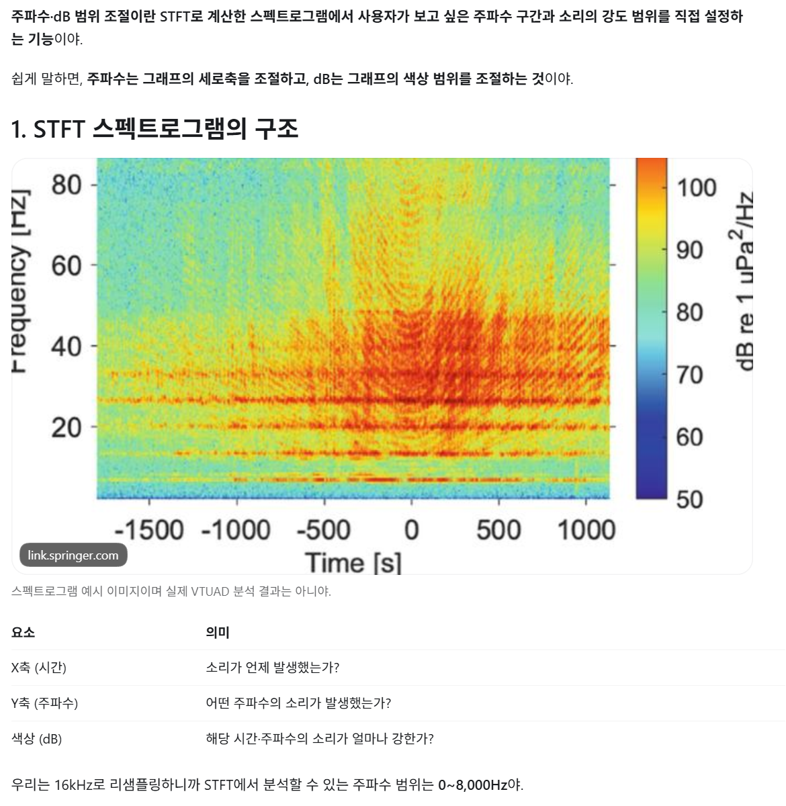

## 과제내용 해석 
주파수·dB 범위 조절이란 STFT로 계산한 스펙트로그램에서 사용자가 보고 싶은 주파수 구간과 소리의 강도 범위를 직접 설정하는 기능

## dsp/ 설명

### 하는 일
1. 오디오 신호의 주파수 분석
2. STFT 계산 및 분석 결과 관리
3. 향후 Log-Mel / LOFAR / DEMON 분석 기능 추가

### 사용하는 곳
1. Explorer: 음향 분석 및 시각화
2. AI Classifier: 모델에서 사용할 음향 특징 생성 시 활용 가능

## stft_cache.py 설명

### 하는 일
1. 캐시 확인
이미 저장된 STFT 분석 결과가 있는지 검사

2. STFT 계산 요청
캐시가 없거나 유효하지 않으면 STFT를 새로 계산

3. NPZ 저장 및 재사용
주파수·시간·파워 배열을 저장하고 재사용 - analysis_cache에 NPZ파일은 저장됨 

4. 설정 및 파일 변경 확인
YAML 설정과 WAV 정보를 이용해 캐시 유효성 검사

### 사용하는 곳
1. Explorer: 분석 결과를 빠르게 불러올 때
2. Flask API: STFT 결과를 브라우저에 전달할 때 (예정)

## stft.py 설명

### 하는 일
1. STFT 계산
시간에 따른 주파수 성분 분석

2. 파워 계산
복소수 STFT 결과를 파워 스펙트럼으로 변환

3. 분석 결과 반환
주파수, 시간, 파워 배열 반환

### 사용하는 곳
1. stft_cache.py: 캐시가 없을 때 STFT 계산
2. Explorer: 스펙트로그램 데이터 생성
